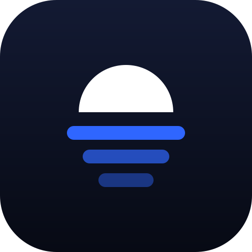
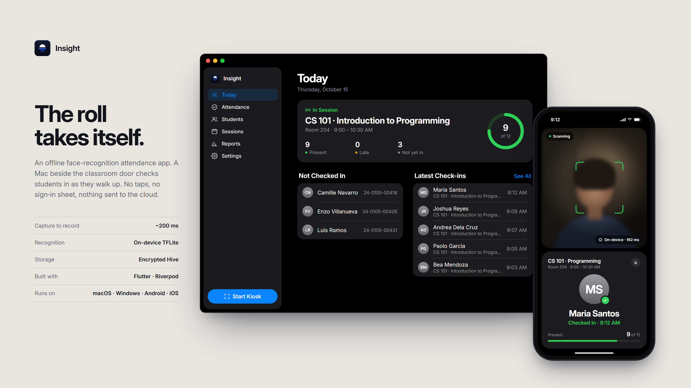
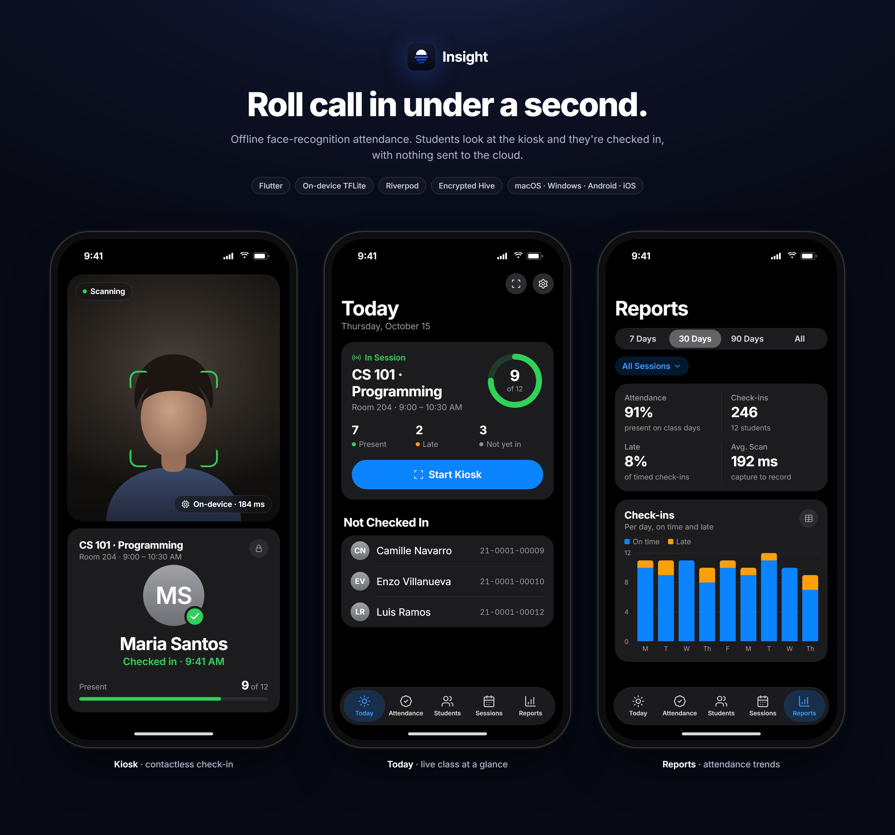
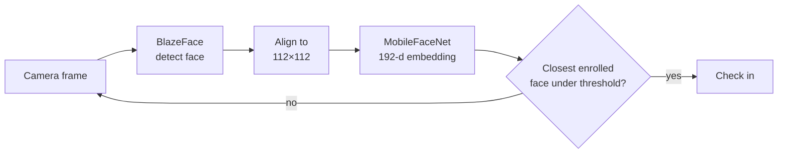

<div align="center">



# Insight

**Roll call in under a second.**

Offline face-recognition attendance. Students look at the kiosk and they're checked in,<br>
with nothing sent to the cloud.


</div>

<br>



## What it does

A device beside the classroom door runs **Kiosk** mode. Students walk up, the camera finds a face, and Insight matches it against the faces enrolled on that device. No taps, no sign-in sheet, no network.

| | |
|---|---|
| **Today** | The class in session, who's present or late, and who hasn't shown up yet. |
| **Attendance** | Every check-in, filterable by student, session and date, with saved filters and CSV export. |
| **Students** | Guided five-angle enrollment from the camera or photos, plus per-student history. |
| **Sessions** | The weekly class schedule that decides which class a check-in belongs to. |
| **Reports** | Attendance rate, lateness and scan speed over 7, 30 or 90 days, or all time, plus who needs follow-up. |
| **Settings** | Admin lock, backup and restore, and data maintenance. |



## How recognition works



- **On-device only.** Both TFLite models ship in `assets/models/` and run in a background isolate, so the UI never stalls.
- **Fast.** Capture to record takes about 200 ms on a laptop.
- **Careful.** A match must beat the distance threshold *and* be clearly ahead of the next-closest student.
- **Private.** Student data lives in an encrypted Hive database; the key is kept in the platform's secure storage.

## Getting started

Requires Flutter with Dart `^3.12`.

```bash
git clone https://github.com/HeeJinn/insight.git
cd insight
flutter pub get
flutter run
```

The models and generated Hive adapters are already committed. To see every screen without enrolling real faces, start a debug build with sample data:

```bash
flutter run --dart-define=INSIGHT_DEMO=true
```

Run the tests:

```bash
flutter test
```

If you change a Hive model in `lib/models/`, regenerate its adapter:

```bash
dart run build_runner build
```

## Project layout

```
lib/
├── screens/     Today, Attendance, Students, Sessions, Reports, Settings, Kiosk
├── services/    face pipeline, live tracking, reports, CSV export, backup
├── providers/   Riverpod state: Hive boxes, sessions, settings, admin lock
├── models/      Student, Attendance, SessionEntry
├── ui/          theme, glass tab bar, adaptive shell, shared widgets
└── widgets/     camera scanner, face overlay, guided capture
```

## Built with

[Flutter](https://flutter.dev) ·
[Riverpod](https://riverpod.dev) ·
[go_router](https://pub.dev/packages/go_router) ·
[tflite_flutter](https://pub.dev/packages/tflite_flutter) ·
[Hive CE](https://pub.dev/packages/hive_ce) ·
[camera](https://pub.dev/packages/camera) ·
[Lottie](https://pub.dev/packages/lottie) ·
[Inter](https://rsms.me/inter/)

Google ML Kit draws the live face overlay on Android and iOS. It only affects what's drawn on screen; recognition is always TFLite.

<div align="center">
<br>
<sub>Built as a thesis prototype.</sub>
</div>
